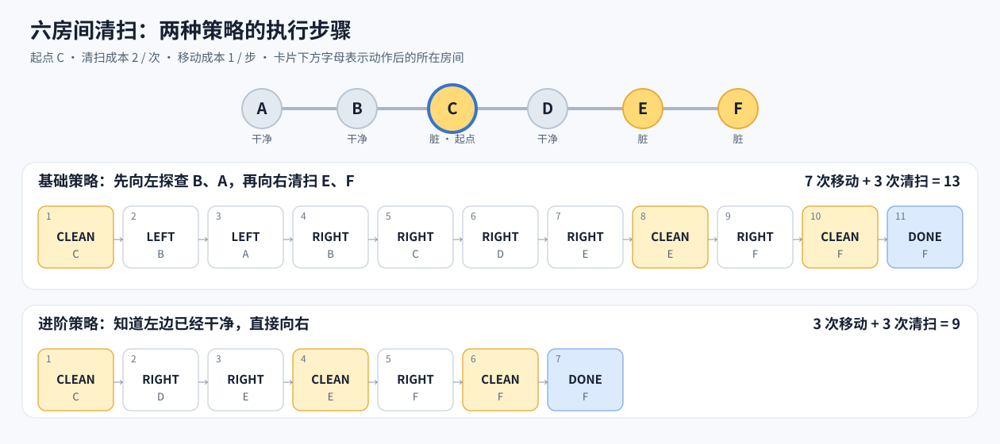

# Agent 系统基础：六房间清扫

房间按 `A -- B -- C -- D -- E -- F` 排列。Agent 的函数只**返回动作**；`execute()` 才会改变环境状态。

在项目根目录运行：

```bash
.venv/bin/python 00_agent_system_basics/cleaning_agent.py
```

代码与功能解释：

- `basic_agent()` 只看到当前房间是否脏，并记住已经确认干净的房间。
- `optimal_agent()` 能看到全部房间，比较“先到最左脏房间”和“先到最右脏房间”的路线。因为清扫次数固定，移动路线较短的方案总成本最低。
- 移动成本为 `1`，清扫成本为 `2`；可修改脚本开头的常量。
- `verify()` 从 384 种可能的初始情况中随机抽取 100 种不重复的组合。它检查清扫完成、动作合法、18 步内结束，以及进阶策略的成本是否等于理论最低成本，最后打印平均成本。固定随机种子为 `42`，便于复现结果。

## 示例：从 C 出发

初始状态为 **A、B、D 干净，C、E、F 脏**。下图每张卡片上方是动作，下方是执行该动作后所在的房间；黄色卡片表示清扫。



- **基础策略**只知道当前位置是否脏。清扫 C 后，它向左查看 B，再到 A 确认干净，然后折返并向右清扫 E、F。共移动 7 次、清扫 3 次，成本为 `7 × 1 + 3 × 2 = 13`。
- **进阶策略**一开始就知道 A、B 干净。它清扫 C 后直接向右，清扫 E、F。共移动 3 次、清扫 3 次，成本为 `3 × 1 + 3 × 2 = 9`。

两者清扫次数相同；基础策略多出的 4 次移动来自向左探查和折返。
