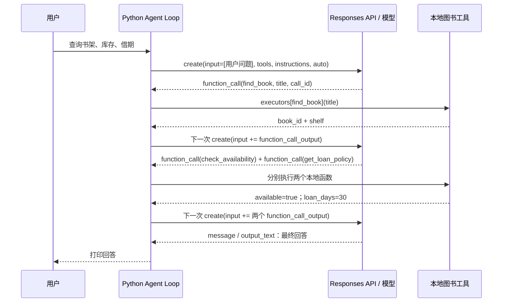

# LLM Agent 如何决定调用工具：真实运行对照报告

## 1. 先看结论

1. **LLM 决定的是“请求什么”**。它返回 `function_call`，其中有工具名、JSON 格式的参数和 `call_id`；它没有直接运行本地 Python 函数。本实验工具调用轮次的 `output_text` 是空字符串，最终回答轮次才出现给用户看的文本。有些响应还会包含 `reasoning` 项，因此“没有正文”不等于“完全没有输出”。
2. **Python 决定“是否、如何执行”**。程序从 `response.output` 提取 `function_call`，用 `executors.get(call.name)` 查白名单，解析参数后执行本地函数，再用同一 `call_id` 构造 `function_call_output`。下一次 `client.responses.create(...)` 才会把执行结果交回模型。
3. **省略 `tool_choice` 与显式传 `"auto"` 的规则相同**。本次 9 对配置的调用路径和次数也相同；答案措辞略有变化。`"none"` 则使 9 组运行全部变成 1 次模型调用、0 次工具请求、0 次工具执行，模型只能说无法核实本地数据。
4. **省略 `instructions` 仍然可能正常调用工具**。本次三个场景的 `none + auto` 都完成了所需查询。因为用户问题、工具名称和工具描述仍然提供了足够明确的任务线索。这说明长指令不是 API 调用工具的语法前提；不能据此推断所有更复杂任务都不需要约束。
5. **一轮 API 调用可以返回多个工具请求**。基线第 2 轮一次返回 `check_availability` 与 `get_loan_policy`；A 场景第 4 轮一次返回两个库存检查。模型 API 次数、工具请求次数、Python 实际执行次数因此是三种不同指标。

官方文档说明：省略 `tool_choice` 时默认为 `auto`；`auto` 可选择零个、一个或多个工具调用，`none` 禁止调用，`required` 要求调用。模型给出调用请求后，由应用执行并回传结果。[OpenAI Function calling 指南](https://developers.openai.com/api/docs/guides/function-calling)

## 2. 实验怎样控制变量

三个场景均使用同一组工具定义和同一份本地图书字典；A 仅修改目标书的 `available`，B 仅修改用户问题。对照脚本对每组配置创建独立字典和客户端，最多运行 8 轮；单独的“每轮 `required`”实验最多运行 3 轮。

| 场景 | 用户的问题与本地事实 | 想观察什么 |
| --- | --- | --- |
| `baseline` | 查询 `Python Basics` 的位置、库存、借期；本地数据为 `3F, Section A`、可借、30 天。 | 正常查询链。 |
| `A` | **问题与基线完全相同**，但把 `Python Basics.available` 改成 `False`；`Practical Python` 可借 21 天，`Advanced Python` 不可借。 | 工具结果改变后，模型是否继续找并核实备选。 |
| `B` | 查询不存在的 `The Missing Book`。 | 模型收到 `{"error":"Book not found"}` 后如何回答。 |

指令设置：

| 报告名称 | 实际发送给 API 的 `instructions` |
| --- | --- |
| `full` | [主教学脚本中的完整 `INSTRUCTIONS`](agent_loop.py)，包含核实图书、不可借时推荐至多一本已核实备选、不能编造编号与借期等具体规则。 |
| `short` | `Use the available tools to verify library information before answering. Do not invent book details. Answer in English.` |
| `none` | **完全不传** `instructions` 参数，不是传空字符串。 |

工具选择设置：

| 报告名称 | 实际每轮传给 API 的参数 |
| --- | --- |
| `auto` | 每轮显式传 `tool_choice="auto"`。 |
| `omitted` | 每轮省略 `tool_choice`。官方默认行为是 `auto`。 |
| `none` | 每轮传 `tool_choice="none"`。工具 schema 仍在请求中，只是不允许模型请求工具。 |
| `required-first` | **对照脚本定义的组合模式，不是 API 的单个枚举值**：首轮传 `"required"`，之后传 `"auto"`，让模型可以结束。 |
| `required` | 额外边界实验：每一轮都传 `"required"`。 |

这里的 `none` 可能指两件不同的事：`instruction_mode=none` 是不传指令；`tool_choice_mode=none` 是禁止工具调用。下面表格把两列分开。

## 3. 36 组主对照的实际结果

表中 `API/请求/执行` 依次为 `client.responses.create` 次数、模型输出的 `function_call` 数量、Python 实际执行本地函数的次数。`F= find_book`，`V= check_availability`，`L= get_loan_policy`，`S= find_similar_books`。同一括号内的多个字母表示**一次模型响应中同时提出**的多个请求。所有 `auto`、`omitted`、`required-first` 运行都得到完整文本；`tool_choice=none` 也得到文本，但未核实任何图书事实。

### 3.1 `baseline`：目标书可借

| 指令 | 工具选择 | API/请求/执行 | 逐轮工具请求 | 本次最终回答的事实内容 |
| --- | --- | ---: | --- | --- |
| full | auto | 3/3/3 | F → (V, L) | 3F A 区；可借；30 天。 |
| full | omitted | 3/3/3 | F → (V, L) | 3F A 区；可借；30 天。 |
| full | none | 1/0/0 | 无 | 说无法核实位置、库存和借期。 |
| full | required-first | 3/3/3 | F → (V, L) | 3F A 区；可借；30 天。 |
| short | auto | 3/3/3 | F → (V, L) | 3F A 区；可借；30 天。 |
| short | omitted | 3/3/3 | F → (V, L) | 3F A 区；可借；30 天。 |
| short | none | 1/0/0 | 无 | 说无法核实位置、库存和借期。 |
| short | required-first | 3/3/3 | F → (V, L) | 3F A 区；可借；30 天。 |
| none | auto | 3/3/3 | F → (V, L) | 3F A 区；可借；30 天。 |
| none | omitted | 3/3/3 | F → (V, L) | 3F A 区；可借；30 天。 |
| none | none | 1/0/0 | 无 | 说无法核实位置、库存和借期。 |
| none | required-first | 3/3/3 | F → (V, L) | 3F A 区；可借；30 天。 |

例如 `full + auto` 的实际最终文本是：

> “Python Basics” is on **3F, Section A**. It is **available now**, and you can borrow it for **30 days**.

`full + none` 的实际最终文本是：

> I can’t access the library catalog right now, so I can’t confirm where “Python Basics” is, whether it’s available, or its loan period. I also can’t verify an available alternative on the same topic.

后一段不能证明本地目录真的不可访问；模型的意思是**在这次 API 交互中不能调用目录工具**。Python 的字典仍然存在，只是 `tool_choice="none"` 阻止了模型发起工具请求。

### 3.2 `A`：同一个问题，库存变为不可借

| 指令 | 工具选择 | API/请求/执行 | 逐轮工具请求 | 本次最终回答的事实内容 |
| --- | --- | ---: | --- | --- |
| full | auto | 6/7/7 | F → (V, L) → S → (V, V) → L | 原书不可借；推荐已核实可借的 Practical Python，3F B 区，21 天。 |
| full | omitted | 6/7/7 | 同上 | 同上。 |
| full | none | 1/0/0 | 无 | 无法核实原书或备选。 |
| full | required-first | 6/7/7 | 同上 | 原书不可借；推荐 Practical Python，3F B 区，21 天。 |
| short | auto | 6/7/7 | 同上 | 原书不可借；推荐 Practical Python，3F B 区，21 天。 |
| short | omitted | 6/7/7 | 同上 | 同上。 |
| short | none | 1/0/0 | 无 | 无法核实原书或备选。 |
| short | required-first | **5/8/8** | F → (V, L) → S → (V, V, L, L) | 事实结论相同；这一轮并行请求了 4 个工具，包括不可借候选的借期。 |
| none | auto | 6/7/7 | F → (V, L) → S → (V, V) → L | 原书不可借；推荐 Practical Python，3F B 区，21 天。 |
| none | omitted | 6/7/7 | 同上 | 同上。 |
| none | none | 1/0/0 | 无 | 无法核实原书或备选。 |
| none | required-first | 6/7/7 | 同上 | 原书不可借；推荐 Practical Python，3F B 区，21 天。 |

`full + auto` 的实际最终文本：

> “Python Basics” is on **3F, Section A**, but it is **unavailable**. Its loan period is **30 days**.
>
> An available book on the same topic is **Practical Python**, on **3F, Section B**. Its loan period is **21 days**.

特别注意：`find_similar_books` 只提供候选的书名、编号、位置，**不提供可借结论**。本次模型在第 4 轮分别检查 `bk-208` 与 `bk-305`，得到 `true` 与 `false` 后，才选 `Practical Python`。A 与基线的用户问题相同，后续路径之所以不同，是第 2 轮工具结果由 `true` 变成了 `false`。

`short + required-first` 的 5/8/8 说明：**API 轮数少不代表工具执行更少**；模型把四个请求放在同一次响应里，还查询了后来证实不可借的 `bk-305` 的借期。当前教学程序会按请求逐一执行。

### 3.3 `B`：工具返回错误

| 指令 | 工具选择 | API/请求/执行 | 逐轮工具请求 | 本次最终回答的事实内容 |
| --- | --- | ---: | --- | --- |
| full | auto | 2/1/1 | F | 未找到；不能确认位置、库存、借期或同主题备选。 |
| full | omitted | 2/1/1 | F | 同上。 |
| full | none | 1/0/0 | 无 | 无法确认，但没有实际查询目录。 |
| full | required-first | 2/1/1 | F | 未找到；不能确认详情或备选。 |
| short | auto | 2/1/1 | F | 未找到；不能确认详情或备选。 |
| short | omitted | 2/1/1 | F | 同上。 |
| short | none | 1/0/0 | 无 | 无法确认，但没有实际查询目录。 |
| short | required-first | 2/1/1 | F | 未找到；不能确认详情或备选。 |
| none | auto | 2/1/1 | F | 未找到；不能确认详情或备选。 |
| none | omitted | 2/1/1 | F | 同上。 |
| none | none | 1/0/0 | 无 | 无法确认，但没有实际查询目录。 |
| none | required-first | 2/1/1 | F | 未找到；不能确认详情或备选。 |

`full + auto` 的完整回答：

> I couldn’t find **The Missing Book**, so I can’t confirm its shelf, availability, or loan period. Since its topic couldn’t be confirmed, I can’t verify or recommend a similar book.

这里 `F` 的 Python 结果是 `{"error":"Book not found"}`。模型在收到这个结果之后结束，没有凭空生成图书编号。需要区分 `tool_choice=none` 的“没有核实”和工具实际返回错误后的“查过但没找到”：两种最终措辞都可能谨慎，证据来源却不同。

## 4. 把一次完整调用链拆开

以下是 `baseline + full + auto` 这次实测的关键字段。`call_id` 是 API 生成的关联标识，值每次可能不同，重要的是回传时保持一致。



### 第 1 轮：模型只给出请求，Python 才执行

第一次 `client.responses.create(...)` 的输入历史只有用户问题，返回的可用内容是：

```json
{
  "type": "function_call",
  "name": "find_book",
  "arguments": "{\"title\":\"Python Basics\"}",
  "call_id": "call_HmPagACbp8t0hRdro2m7Ctc8",
  "status": "completed"
}
```

这轮 `response.output_text == ""`。其中 `arguments` **是 JSON 字符串，不是已经解析好的 Python 字典**；`status="completed"` 只表示这条**模型输出项**已生成，不表示本地 `find_book` 已执行。实际执行发生在 Python 的 `json.loads(call.arguments)`、`executors.get(call.name)` 和 `function(**args)`。本次函数返回：

```json
{"book_id":"bk-102","shelf":"3F, Section A"}
```

程序随即追加到 `history` 的内容等价于：

```json
{
  "type": "function_call_output",
  "call_id": "call_HmPagACbp8t0hRdro2m7Ctc8",
  "output": "{\"book_id\": \"bk-102\", \"shelf\": \"3F, Section A\"}"
}
```

这条结果是**下一轮请求的输入**，不是第 1 轮 API 返回时模型就已经知道的值。

### 第 2 轮：一次模型请求产生两个工具请求

第 2 次 API 调用发送了 3 个历史项：用户问题、上一轮模型的 `function_call`、Python 的 `function_call_output`。模型此时已经看见 `bk-102`，一次返回：

```text
function_call #1: check_availability({"book_id":"bk-102"})
function_call #2: get_loan_policy({"book_id":"bk-102"})
response.output_text: ""
```

Python 对这两个请求分别执行函数，得到 `{"available":true}` 与 `{"loan_days":30}`，并分别用各自的 `call_id` 回传。此时累计 **2 次 API 调用、3 个工具请求、3 次本地执行**。

### 第 3 轮：模型给出面向用户的文本

第 3 次 API 调用发送 7 个历史项：原始用户问题、前两轮共 3 个模型工具调用项、对应的 3 个工具结果。模型返回 `message`，没有新的 `function_call`；`response.output_text` 才是上表中的完整答案。Python 的 `if not calls: break` 因而结束循环。本次总计 **3 次 API 调用、3 个工具请求、3 次本地执行**。

代码中的对应位置：

```python
response = client.responses.create(
    model=model, instructions=INSTRUCTIONS, tools=TOOLS,
    tool_choice="auto", input=history,
)
history.extend(response.output)
calls = [item for item in response.output if item.type == "function_call"]

for call in calls:
    args = json.loads(call.arguments)
    function = executors.get(call.name)
    result = function(**args) if function else {"error": "Unauthorized tool"}
    history.append({
        "type": "function_call_output", "call_id": call.call_id,
        "output": json.dumps(result, ensure_ascii=False),
    })
```

上面是关键路径的缩写；[主脚本](agent_loop.py)还处理非法参数、计数、轨迹和循环上限。保留整轮 `response.output`（可能含 `reasoning` 项）再回传工具结果，符合 [OpenAI 推理模型文档](https://developers.openai.com/api/docs/guides/reasoning)对多轮工具调用的要求。

## 5. 同一个问题如何走出另一条路径

`A + full + auto` 的逐轮实际轨迹如下。与基线不同的关键是第 2 轮的 `available=false`。

| 轮次 | 模型返回的请求 | Python 本地执行结果 | 下一步为何变化 |
| ---: | --- | --- | --- |
| 1 | `find_book("Python Basics")` | `bk-102`，`3F, Section A` | 获得可用于后续查询的编号。 |
| 2 | `check_availability(bk-102)`；`get_loan_policy(bk-102)` | `available=false`；`loan_days=30` | 原书不可借，继续找同主题书。 |
| 3 | `find_similar_books(bk-102)` | 候选 `bk-208 Practical Python`、`bk-305 Advanced Python`，附位置。 | 候选尚未核实库存。 |
| 4 | `check_availability(bk-208)`；`check_availability(bk-305)` | 前者 `true`，后者 `false`。 | 只考虑前者。 |
| 5 | `get_loan_policy(bk-208)` | `loan_days=21`。 | 已具备回答所需事实。 |
| 6 | 无工具请求；返回 `message`。 | 无本地函数执行。 | 循环结束，输出原书不可借及已核实备选。 |

这个对照展示的是**反馈驱动决策**：Python 没有写死“如果不可借则下一轮调用 S”的分支；模型根据第 2 轮的工具结果，自己提出下一轮请求。Python 仍然控制可用工具、数据、执行许可与轮数。

## 6. `tool_choice` 的边界：省略、禁止与强制

### 省略参数和 `auto`

`compare_settings.py` 在 `omitted` 模式下真的没有把 `tool_choice` 放进 `client.responses.create` 的参数字典。官方默认行为为 `auto`。本次 9 对同场景、同指令的对照在调用数量和工具路径上相同，但最终答案用词未必相同，因此“默认规则相同”不等于“每次字节级输出相同”。

### `none`

9 组 `tool_choice="none"` 均返回 `message`，没有 `function_call`，故 `executors.get(...)` 没有机会运行。工具 schema 虽然被发送给 API，模型也不能据此读取本地字典。本次模型选择谨慎地说明无法核实，避免了虚构书架和库存；在其他提示与模型下，不能仅靠这组结果保证永不编造。

### 首轮 `required` 与每轮 `required`

`required-first` 只在首轮强制至少一个工具调用，后续切回 `auto`，因此 9 组都能以正常 `message` 结束。`baseline + full + required-first` 实测仍为 3/3/3。

额外的 `baseline + full + required` 实验**每一轮都传 `required`**。前两轮分别调用 `find_book` 和 `(check_availability, get_loan_policy)`；第三轮顶层 `response.status` 是 **`incomplete`**，`incomplete_details.reason` 是 **`max_messages`**，本轮没有新的 `function_call`。该响应含一段部分文本，但由于状态并非 `completed`，对照脚本记录为 `response_incomplete`，**不把它当成最终回答**。本次累计仍是 3/3/3。这个结果提示：在已经拿齐事实、需要回答用户时，继续每轮强制工具调用可能让流程无法干净结束；不能仅依据 `output_text` 非空判断成功。

本实验具体出现的 `incomplete/max_messages` 是这次模型与服务返回的事实，不应理解为所有模型或每次 `required` 都必然出现相同错误。实用的循环应检查响应状态，并在允许完成回答的轮次使用 `auto`。`required-first` 正是为了展示这一点。API 参数的正式定义见 [Responses Python 参考](https://developers.openai.com/api/reference/python/resources/responses/methods/create)。

## 7. 如何重现与读原始记录

在项目根目录运行：

```bash
source .venv/bin/activate
python 01_llm_agent_and_toolcalling/agent_loop.py baseline --trace
python 01_llm_agent_and_toolcalling/compare_settings.py
```

第一条运行[独立的主教学脚本](agent_loop.py)：它始终使用完整指令与 `tool_choice="auto"`，保留自由选择工具的核心 Agent Loop。

第二条运行[独立的对照脚本](compare_settings.py)：会重新请求 API 并覆盖 [comparison_runs.json](comparison_runs.json)，产生新的随机调用轨迹和费用。

本报告是上面标注时间的一次快照，不会自动随重跑后的 JSON 更新。

JSON 的路径可这样读：

```text
runs[]
  scenario / instruction_mode / tool_choice_mode
  run.status / run.final_answer / run.counts
  run.rounds[]
    request.tool_choice_sent / request.history_items_sent
    response.status / response.output_items / response.output_text / response.usage
    tool_results[]: call_id / name / arguments / executed / result
```

主对照的多数记录是在补充顶层 `response.status` 字段之前采集的，因此该字段在这些记录里不存在；该轮已返回最终文本并成功结束。单独复跑的 `required` 记录包含顶层状态及 `incomplete_details`。`comparison_runs.json` 不含 API key。模型输出中的 `reasoning` 仅记录类型，不是可供我们读取的完整内部推理文本。

要自己比较某一项，先看模型本轮的 `output_items`：它是 `function_call` 还是 `message`？再看同轮 `tool_results`：Python 是否执行、结果是什么？最后看下一轮 `request.history_items_sent` 是否增加。沿着 `call_id`，就能分清**模型决策、程序执行、模型读取反馈**这三个时间点。
