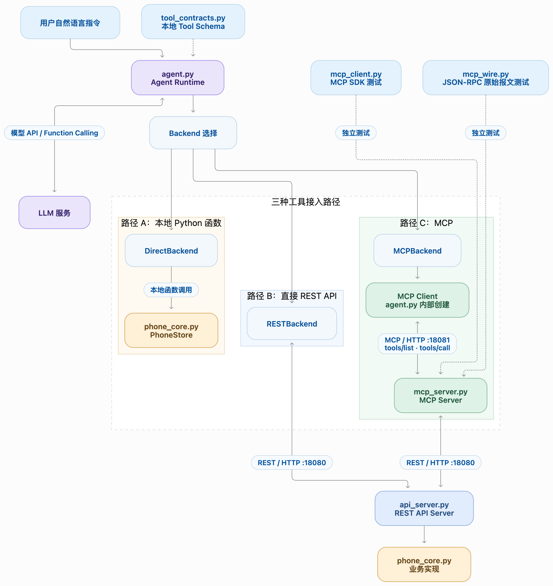
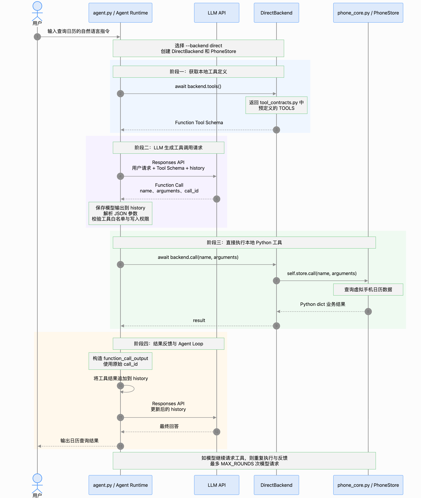
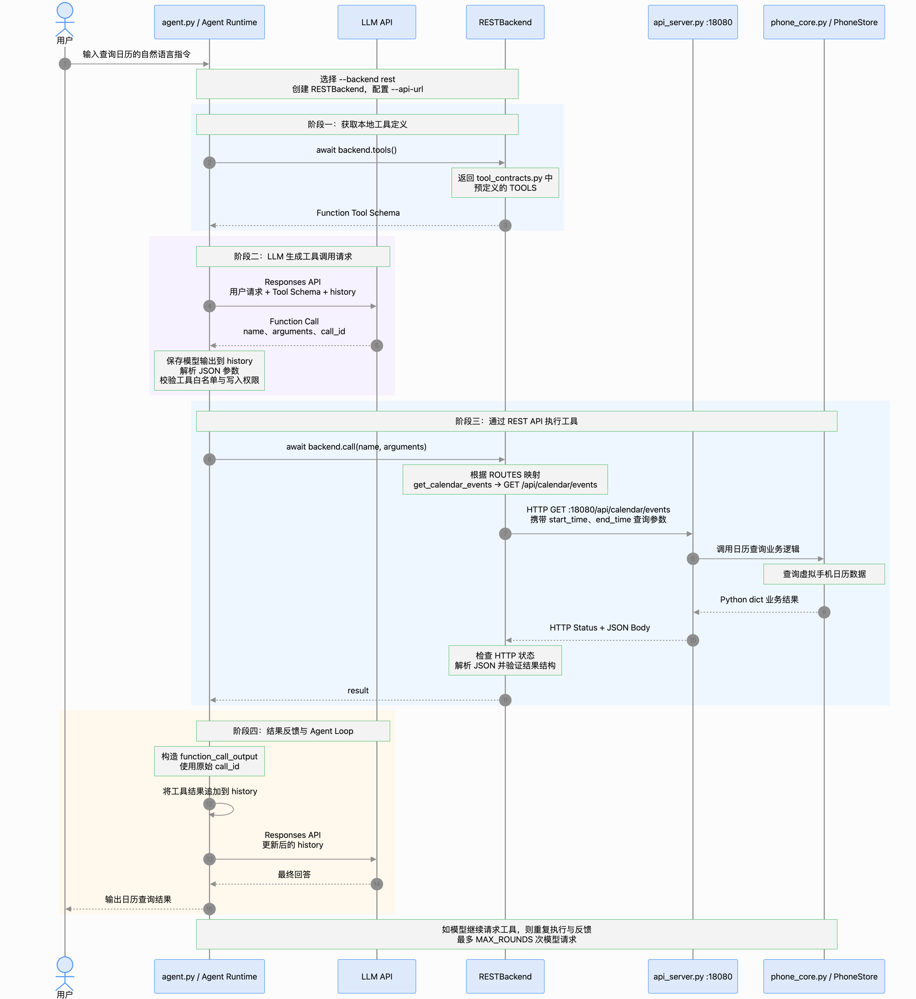
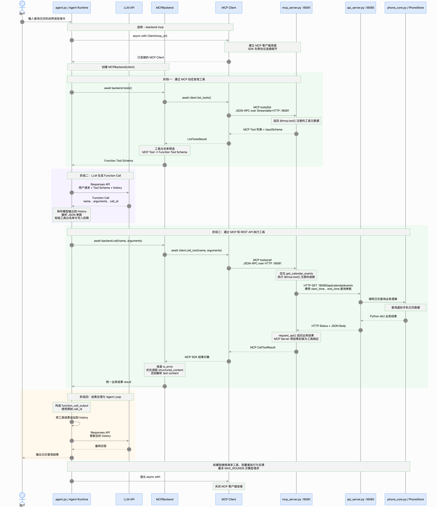

# Agent 外部能力连接：本地函数、REST API 与 MCP

在图书馆 Agent 中，模型已经会根据问题和工具结果决定下一步。但那个例子的工具、数据和执行代码都放在同一个 Python 程序里。现在换一个更接近实际应用的场景：用户希望终端助手查看手机日历、搜索备忘录，必要时还要创建新内容。日历和备忘录各有自己的数据与接口，Agent 必须先接上这些能力，才能完成任务。

本节用一部**虚拟手机**搭建这条链路。同一个 Agent Loop 先直接执行 Python 函数，再直接请求 REST API，最后通过 MCP Server 使用同一个 API。三次实验保持问题和工具能力相同，让你逐层看清网络调用与协议接入增加了什么。全部数据都是本地模拟，不会读取或修改真实手机。

读完并动手运行后，你应能回答三个问题：

1. 模型说“我要调用工具”时，API 实际返回了什么？
2. 谁负责校验参数、执行读写、把结果交回模型？
3. 直接 REST API 与 MCP 有什么区别？工具如何被发现、请求如何穿过不同端口？

## 先建立一张概念地图

把四个常见术语放在同一个任务中，更容易理解它们的关系。

| 概念 | 在本实验中具体指什么 | 它负责什么 |
| --- | --- | --- |
| Tool（工具） | `get_calendar_events`、`create_note` 等能力 | 告诉 Agent 有哪些可用操作，以及各操作需要哪些参数。 |
| Function Calling | Responses API 返回 `function_call`，Python 回传 `function_call_output` | 让模型**提出**带名称和参数的调用请求；应用程序完成执行与反馈。 |
| REST API | 虚拟手机的 HTTP 服务，例如 `GET /api/calendar/events` | 让其他进程通过明确的 HTTP 方法、路径和响应访问日历、备忘录。 |
| MCP | MCP Server 暴露工具，MCP Client 执行 `list_tools()` 和 `call_tool()` | 让工具通过统一协议被发现和调用。 |

一个关键分界是：**模型输出的工具请求不是工具执行结果**。按 [OpenAI 官方 Function calling 指南](https://developers.openai.com/api/docs/guides/function-calling)描述的流程，应用程序先把工具说明交给模型；模型返回调用请求；应用程序执行代码，再把结果送回模型，模型才继续回答。

在本地函数和 REST 两种模式中，[`tool_contracts.py`](tool_contracts.py) 用 JSON Schema 说明参数，并启用 `strict=True` 约束模型生成的调用格式。Schema 说明“怎样提出请求”；是否接受这次请求，仍由 Python 的白名单、参数校验和写入开关决定。

### 先认清每个 Python 文件的职责

运行命令前，可以先看清哪些文件在主链路中，哪些是用于单独观察某一层的实验入口。

| 文件 | 系统角色 | 主要职责 |
| --- | --- | --- |
| [`agent.py`](agent.py) | Agent Runtime；使用 MCP 时也是 MCP Host | 调用模型、选择工具接入后端、执行 Agent Loop、将工具结果回填给模型。 |
| [`tool_contracts.py`](tool_contracts.py) | 本地工具契约 | 为 `direct` 和 `rest` 提供模型可见的工具名称、说明与参数 Schema。 |
| [`phone_core.py`](phone_core.py) | 业务逻辑层 | 用 `PhoneStore` 实现虚拟日历、备忘录，以及输入校验和业务错误。 |
| [`api_server.py`](api_server.py) | REST API Server | 把 `PhoneStore` 暴露为 HTTP 接口，供 `rest` 和 MCP Server 使用。 |
| [`mcp_server.py`](mcp_server.py) | MCP Server | 发布可发现的工具，并将工具调用转换成对 REST API 的请求。 |
| [`mcp_client.py`](mcp_client.py) | 独立的 MCP SDK 实验入口 | 不调用模型，直接用 SDK 发现工具并执行一次只读调用。 |
| [`mcp_wire.py`](mcp_wire.py) | 独立的 MCP 协议实验入口 | 不调用模型或 MCP SDK，亲手构造 HTTP 与 JSON-RPC 消息。 |
| [`test_phone.py`](test_phone.py) | 自动化验证 | 检查业务规则、REST 接口及 `RESTBackend` 的请求映射。 |

`mcp_client.py` 和 `mcp_wire.py` 是**两个可分别运行的观察实验**，不是 `agent.py --backend mcp` 执行时依次经过的组件。主程序内部创建自己的 MCP Client，直接连接 `mcp_server.py`。

### 这个虚拟手机里有什么

程序启动时，[`phone_core.py`](phone_core.py) 会放入两条初始数据：

- 日历：2026 年 11 月 9 日 10:30–11:30，**产品评审会议**。
- 备忘录：标题为**项目待办**，正文包含“准备产品评审材料”。

默认问题要求查询当天 10:00–11:00 的日程，并搜索含“评审”的备忘录。10:30 开始的会议与查询时段有重叠，所以日历结果应有 1 条；备忘录结果也应有 1 条。程序固定使用这组日期与 `+08:00` 时区，便于你反复比较三条调用路径。

可用操作如下：

| 工具 | 输入 | 读写 | 值得观察的规则 |
| --- | --- | --- | --- |
| `get_calendar_events` | `start_time`、`end_time` | 读 | 时间须带时区；按半开区间 `[start, end)` 判断重叠。 |
| `create_calendar_event` | `title`、`start_time`、`end_time` | 写 | 标题不能为空；与已有日程冲突时返回 `CALENDAR_CONFLICT`。 |
| `search_notes` | `keyword` | 读 | 同时搜索标题和正文；空字符串表示列出全部。 |
| `create_note` | `title`、`content` | 写 | 标题和内容都不能为空。 |

四个工具最终都使用同一套 `PhoneStore` 业务代码。它还会检查工具名是否在白名单、参数是否恰好包含规定字段，以及时间跨度是否超过 7 天。`direct` 每次运行时创建自己的 `PhoneStore`；`rest` 与 `mcp` 则访问 REST API 进程里的同一个实例。比较结果时，应先确保各路径使用相同的初始数据。

## 三条路径：模型相同，接线方式不同

`agent.py` 中只有一个 Agent Loop。改变 `--backend`，就能切换工具如何到达虚拟手机：



[查看架构图原尺寸](images/tool-access-architecture.png)。图右侧的 `mcp_client.py` 与 `mcp_wire.py` 是独立测试入口；三条主路径的业务结果沿各自的调用链返回 `agent.py`，再由它构造 `function_call_output` 交给下一轮 Responses API 调用。

三条路径都由模型选择下一步，也都由 `agent.py` 把工具结果送回 Responses API。差别发生在**工具定义来源与执行**这一段：

- `direct` 读取 [`tool_contracts.py`](tool_contracts.py) 手写的 JSON Schema，然后直接调用 `PhoneStore`。
- `rest` 复用同一份 Schema；[`RESTBackend`](agent.py) 把工具名映射成固定的 HTTP 方法与路径，直接请求 [`api_server.py`](api_server.py)。模型不能指定任意 URL。
- MCP 路径先调用 `list_tools()`，取得 MCP Server 发布的工具名、说明和输入 Schema；模型提出请求后，Python 再用 `call_tool()` 调用服务端。服务端经 [`api_server.py`](api_server.py) 访问同一套业务逻辑。

这里采用的是**本地 MCP Client 桥接**。因此三种模式下，Responses API 看到的都是函数工具，模型输出仍是 `function_call`。OpenAI 也支持在 Responses API 中直接配置远程 MCP Server，或通过 Secure MCP Tunnel 连接私有服务器；那条路径会由 API 侧处理 MCP 调用，不属于这个本地实验。[OpenAI MCP 工具指南](https://developers.openai.com/api/docs/guides/tools-connectors-mcp)

> **阅读顺序建议**：先不启动服务，跑通 `direct`；再启动 REST API，用 `rest` 让 Agent 直接访问；最后启动 MCP Server，用 `mcp` 运行同一个问题。这样每增加一层，你都知道它解决了什么问题。

## 准备：先验证本地业务逻辑

以下命令都以**项目根目录**为起点。使用已有的 `.venv`：

```bash
source .venv/bin/activate
python -m pip install -r 02_external_capabilities/requirements.txt
python -m pytest -q 02_external_capabilities/test_phone.py
```

测试覆盖时间区间边界、日程冲突、备忘录查询与创建、非法参数、REST API 错误状态，以及 `RESTBackend` 的 HTTP 映射和错误回传。预期是 `6 passed`。这一步不调用大模型，也不需要启动服务器。

后面的 `agent.py` 会调用真实模型，需要项目根目录 `.env` 中有 `OPENAI_API_KEY` 和 `OPENAI_MODEL`。脚本会自动读取该文件；请勿把真实密钥写进代码或提交到远程。依赖使用 Python 3.11+ 和 MCP Python SDK v2。

## 第一站：直接 Function Calling

从项目根目录运行：

```bash
.venv/bin/python 02_external_capabilities/agent.py --backend direct --trace
```



[查看 direct 时序图原尺寸](images/direct-backend-sequence.png)。图中以一次日历查询为例；默认问题还会查询备忘录，Agent Loop 会重复相同的“模型请求 → 工具执行 → 结果反馈”过程。

默认问题会触发日历与备忘录查询。下面摘自一次真实运行；`call_id` 每次运行都会变化，模型也可能改变工具顺序：

```text
[Round 1] Responses API request: model=..., input_types=['user'], tool_choice=auto, parallel_tool_calls=False
[Round 1] Responses API returned: status=completed, output_types=['function_call'], output_text=(none)
[Round 1] function_call: name=get_calendar_events, arguments={...}, call_id=call_4dwzgT8Kdd6njEa6zA4F8qJf
[Round 1] Python executes via PhoneStore
[Round 1] Python result: {"ok": true, "data": {"count": 1, "events": [...]}}
[Round 1] function_call_output: call_id=call_4dwzgT8Kdd6njEa6zA4F8qJf, output={...}
[Round 2] Responses API request: model=..., input_types=['user', 'function_call', 'function_call_output'], ...
```

按时间顺序读这条轨迹：

1. `agent.py` 把用户问题、工具说明、指令和当前 `history` 作为 `responses.create(...)` 的输入。`tool_choice="auto"` 让模型决定回答还是提出工具调用；`parallel_tool_calls=False` 限制每轮至多提出一个调用。
2. 模型返回 `function_call`：它包含工具名、JSON 参数和 `call_id`。此时 `output_text=(none)` 很正常，表示这一轮**选择了工具请求**，尚无给用户的正文；也可能同时有其他输出项。此时模型**还没读到**日历结果。
3. Python 把模型输出加入 `history`，解析参数，检查白名单和写入授权，接着调用 `PhoneStore`。只有这一行才真正读了虚拟手机数据。
4. Python 创建 `function_call_output`，用**同一个 `call_id`** 把执行结果关联回那次工具请求。下一轮 `input_types` 同时包含 `function_call` 与 `function_call_output`，模型才有依据继续决策。

接着模型可能请求 `search_notes`；当一轮不再返回 `function_call` 时，程序读取 `response.output_text` 打印最终回答。代码里的对应位置是 [`run_agent()`](agent.py)：重点找 `responses.create`、`history.extend(response.output)`、`backend.call(...)` 和 `history.append({... "function_call_output" ...})`。

你还会看到三种计数：

- `model_api`：向 Responses API 发起了多少次模型请求。
- `tool_requests`：模型提出了多少个工具请求。
- `tool_executions`：执行端实际调用后端工具多少次。

例如，模型请求了写工具，但程序拒绝执行时，`tool_requests` 会增加，`tool_executions` 不会增加。程序依然把拒绝原因作为 `function_call_output` 反馈给模型。代码中的白名单与写入开关是执行端规则，模型的指令不能代替它们。本实验设置了 `parallel_tool_calls=False`，因此每轮模型响应至多提出一个函数调用；程序仍遍历返回的调用项，以便清楚展示请求与执行的关系。[OpenAI 官方 Function calling 指南：并行调用](https://developers.openai.com/api/docs/guides/function-calling)

## 第二站：让 Agent 直接调用 REST API

现在把 `PhoneStore` 放进独立的服务进程。Agent 仍用 Function Calling 做决策，但 `RESTBackend` 收到模型的工具请求后，会向该进程发送 HTTP 请求。先用普通 HTTP 客户端观察服务，再运行 Agent，就能区分模型调用与 REST 调用。

新开**终端 A**，从项目根目录执行：

```bash
cd 02_external_capabilities
../.venv/bin/python -m uvicorn api_server:app --host 127.0.0.1 --port 18080
```

浏览器打开 `http://127.0.0.1:18080/docs`，可以看到日历和备忘录的 HTTP 接口。也可以在另一个终端执行：

```bash
curl -G 'http://127.0.0.1:18080/api/calendar/events' \
  --data-urlencode 'start_time=2026-11-09T10:00:00+08:00' \
  --data-urlencode 'end_time=2026-11-09T11:00:00+08:00'
```

这里用 `--data-urlencode`，是为了正确传递时间里的 `+08:00`。返回 JSON 应包含 `"count": 1` 和“产品评审会议”。这条 `curl` 请求只有 HTTP 客户端与 REST API，**没有模型，也没有 MCP**。

保持终端 A 的服务运行，在项目根目录的另一个终端执行：

```bash
.venv/bin/python 02_external_capabilities/agent.py --backend rest --trace
```



[查看 rest 时序图原尺寸](images/rest-backend-sequence.png)。与 direct 图对照看：工具定义仍来自 `tool_contracts.py`，变化的是 `RESTBackend` 把执行步骤转换为发往 `18080` 的 HTTP 请求。

这次模型仍返回 `function_call`。区别在执行阶段：轨迹会先出现 `Python executes via REST API`，接着显示类似下面的 HTTP 请求与响应：

```text
[REST Client] GET http://127.0.0.1:18080/api/calendar/events, arguments={...}
[REST Client] HTTP 200, body={"ok":true,"data":{"count":1,"events":[...]}}
```

[`RESTBackend.call()`](agent.py) 用固定的工具名映射选择 HTTP 方法和路径：查询使用 GET，创建使用 POST；查询参数放在 URL 查询串中，创建参数放在 JSON 请求体中。`--api-url` 只指定 REST API 服务地址，默认是 `http://127.0.0.1:18080`，模型不能通过工具参数改写它。工具 Schema 仍来自 `tool_contracts.py`；REST API 本身不会自动把接口转成这个程序的 Function Tool Schema。REST 服务也有 OpenAPI 描述，可在 `/docs` 查看；本实验没有从 OpenAPI 自动生成工具定义。

REST 返回 HTTP 409 或 422 时，如果响应包含 `PhoneStore` 的 `ok/error` 业务结果，`RESTBackend` 会保留它，让模型知道 `CALENDAR_CONFLICT` 等具体原因。连接故障、服务器错误或不符合约定的响应则由 Agent Loop 转为 `BACKEND_ERROR`。

API 服务独立运行后，日程与备忘录的状态会留在该进程的内存中，直到你停止并重启它。`direct` 每次运行 `agent.py` 都重新初始化；`rest` 和稍后的 `mcp` 则读写同一个 API 进程。比较三种后端时，最好从相同初始数据开始；若已经创建了内容，可以重启 API 服务恢复初始状态。

## 第三站：让 MCP 发布并调用这些能力

保持终端 A 的 API 服务运行。新开**终端 B**，同样从项目根目录执行：

```bash
cd 02_external_capabilities
../.venv/bin/python mcp_server.py
```

MCP Server 监听 `http://127.0.0.1:18081/mcp`。它用 `@mcp.tool()` 发布四个工具；工具参数的类型提示由 SDK 转成输入 Schema。工具被调用时，Server 再向 18080 端口的 REST API 发起请求。

终端 B 还会打印 `[MCP Server → REST API]` 与 `[REST API → MCP Server]`：你能看到 MCP 工具如何变成普通 HTTP 请求，以及 HTTP 状态和业务 JSON 如何回来。终端 A 的访问日志则显示真正抵达 API 的请求。

在**终端 C**，回到项目根目录运行：

```bash
.venv/bin/python 02_external_capabilities/mcp_client.py
```

先看 `mcp_client.py` 的输出：`list_tools()` 能列出四个工具和各自的输入 Schema；`call_tool()` 则真正执行一次日历查询。两者一个是**发现能力**，一个是**使用能力**。本机验证所用的 MCP SDK 2.3.0 在这次调用中把返回的字典放在 `content` 文本块中，`structured_content` 为 `null`；[`MCPBackend.call()`](agent.py) 会将文本解析成 JSON。

### 再往下一层：亲手发送 MCP 协议消息

[`mcp_client.py`](mcp_client.py) 把网络细节交给 SDK。如果想看 SDK 实际包装了什么，运行只读的 [`mcp_wire.py`](mcp_wire.py)：

```bash
.venv/bin/python 02_external_capabilities/mcp_wire.py
```

它不用 MCP SDK，而是用 `httpx` 向 `/mcp` 连续发送三个 HTTP POST。每个 POST 的正文是一条 JSON-RPC 请求：

| 第几个请求 | JSON-RPC `method` | 作用 | `result` 中看什么 |
| --- | --- | --- | --- |
| 1 | `server/discover` | 发现服务端支持的协议版本与能力。 | `supportedVersions`、`capabilities`。 |
| 2 | `tools/list` | 取得工具目录。 | 四个工具的 `name`、`description`、`inputSchema`。 |
| 3 | `tools/call` | 按名称和参数调用日历工具。 | `content` 中的查询结果、`isError`。 |

第三次请求和响应的关键结构如下；实际脚本会打印完整 JSON 和 HTTP 头：

```json
{"jsonrpc":"2.0","id":3,"method":"tools/call","params":{"name":"get_calendar_events","arguments":{"start_time":"2026-11-09T10:00:00+08:00","end_time":"2026-11-09T11:00:00+08:00"},"_meta":{"io.modelcontextprotocol/protocolVersion":"2026-07-28","io.modelcontextprotocol/clientInfo":{"name":"phone-wire-lab","version":"1.0"},"io.modelcontextprotocol/clientCapabilities":{}}}}
```

响应是同一个 `id: 3`，`result.content[0].text` 中放着业务结果。这里的 JSON-RPC `id` 用来匹配 **MCP 客户端与服务端**之间的请求和响应；上一站的 `call_id` 用来匹配 **Responses API 的工具请求与工具反馈**。两个编号属于不同协议，不要求相同。`MCP-Protocol-Version`、`Mcp-Method`、`Mcp-Name` 等 HTTP 头与正文中的版本、方法、工具名相互对应；正常使用 SDK 时，这些细节由 SDK 处理。这个脚本固定使用本项目验证过的 MCP Python SDK 2.x 与 `2026-07-28` 协议版本，用来观察机制，不是通用 MCP 客户端。[MCP 协议架构](https://modelcontextprotocol.io/specification/2026-07-28/architecture)

## 第四站：让模型通过 MCP 使用虚拟手机

保持终端 A、B 运行，在终端 C 执行：

```bash
.venv/bin/python 02_external_capabilities/agent.py --backend mcp --trace
```



[查看 mcp 时序图原尺寸](images/mcp-backend-sequence.png)。这张图在前两条路径的共同 Agent Loop 前后，多展示了 `tools/list` 发现工具、`tools/call` 执行工具，以及 MCP Server 向 `18080` 的 REST API 转接。

与前两站使用**同一个默认问题**。这次 `agent.py` 先连接 MCP Server，发现工具并把 Schema 提供给模型。模型返回 `function_call` 后，`agent.py` 调用 MCP Client；MCP Server 再请求 REST API。最终结果依旧以 `function_call_output` 回到下一轮模型请求。轨迹里会依次出现 `[MCP Client] list_tools()`、模型的 `function_call`、`[MCP Client] call_tool()` 和同一 `call_id` 的 `function_call_output`。可以对照 `mcp_wire.py`：前两个 MCP 操作相当于 `tools/list` 和 `tools/call`，只是 SDK 帮你生成并解析协议消息。

运行完三条路径后，可以比较 `Call counts`、`Elapsed time`、工具结果，以及终端 A、B 的网络日志。`Elapsed time` 包含模型等待时间和工具执行时间，只能用于观察本次完整任务；模型可能改变调用顺序或轮数，因此单次耗时不能证明哪种工具协议更快。要严格测量协议开销，需要固定工具调用序列，排除模型决策的波动。

在一次实际运行中，`direct`、`rest`、`mcp` 都查到了同一场会议和备忘录，各自显示 `model_api=3`、`tool_requests=2`、`tool_executions=2`。这说明三种接入方式在该次任务中都完成了相同的业务目标；每次运行的模型输出仍可能不同。

把同一次日历查询放在各层观察，会得到一条完整的因果链：

| 边界 | 请求长什么样 | 谁执行了什么 |
| --- | --- | --- |
| Python → Responses API | 用户输入、`instructions`、工具 Schema、已有 `history` | 模型决定下一步。 |
| Responses API → Python | `function_call(name, arguments, call_id)` | Python 检查请求；模型没有直接操作手机。 |
| Python → MCP Server | `tools/call`，带工具名和参数 | MCP SDK 编码 HTTP/JSON-RPC，服务端找到 `@mcp.tool()` 包装函数。 |
| MCP Server → REST API | `GET /api/calendar/events?...` | API 调用 `PhoneStore` 查询内存状态。 |
| REST API → Python | HTTP JSON → MCP `content` → Python 字典 | `MCPBackend.call()` 解析执行结果。 |
| Python → 下一轮 Responses API | `function_call_output(call_id, output)` | 模型获得事实，再决定继续调用工具或回答。 |

这也解释了为什么 `mcp_wire.py` 中的 JSON-RPC `id` 和 `agent.py` 中的 `call_id` 分属两层：前者关联一次 MCP 网络请求，后者关联一次模型工具请求。`agent.py` 在 MCP 模式下充当 **MCP Host**，它既持有对话历史，也负责工具许可；MCP Server 只收到执行某个工具所需的参数，不会自动得到整段用户对话。[MCP 架构规范](https://modelcontextprotocol.io/specification/2026-07-28/architecture)

| 比较点 | `direct` | `rest` | `mcp` |
| --- | --- | --- | --- |
| 工具说明来源 | 本地 `tool_contracts.py` | 本地 `tool_contracts.py` | MCP Server 的 `tools/list` |
| Python 怎样执行模型请求 | 调用 `PhoneStore.call()` | 按固定路由发 HTTP 请求 | MCP Client 发送 `tools/call` |
| 经过的服务 | 无 | REST API | MCP Server → REST API |
| 业务状态保存在哪里 | 当前 Agent 进程 | REST API 进程 | 同一个 REST API 进程 |
| 回给模型的格式 | `function_call_output` | `function_call_output` | `function_call_output` |

MCP 提供面向 AI 应用的统一工具发现与调用协议；REST API 也可以有 OpenAPI 描述和代码生成能力。这里比较的是**当前实验实际实现的接入方式**，不能据此断言 REST 天生没有工具描述或 MCP 必须通过 HTTP 访问 REST。

### 两个本地 URL 怎样连接起来

`http://127.0.0.1:18080` 是 REST API 的地址，`http://127.0.0.1:18081/mcp` 是 MCP Server 的地址。`127.0.0.1` 表示本机，端口号区分两个服务进程，路径则由各自服务解释。

- `rest`：`agent.py` 的 `--api-url` 默认指向 `18080`，`RESTBackend` 直接拼接固定的 `/api/...` 路径并发出 HTTP 请求。
- `mcp`：`agent.py` 的 `--mcp-url` 默认指向 `18081/mcp`。MCP Server 收到工具调用后，再用 [`PHONE_API_URL`](mcp_server.py) 指向 `18080`，请求 `/api/...` 路径。**这一步是 `mcp_server.py` 的代码主动转接，不是端口自动传播。**
- 模型 API 是另外一条连接。模型只收到工具名、说明、参数 Schema 和历史，不会自动看到这两个本地地址。

REST API 的端口由启动 `uvicorn` 时的 `--port` 决定；MCP Server 的端口在 `mcp_server.py` 的 `mcp.run(..., port=18081)` 中指定。改端口时，调用方的地址也必须同步修改。特别是 `PHONE_API_URL` 由 **MCP Server 进程**读取；`agent.py` 加载的根目录 `.env` 不会自动传给另一个已启动的进程。

## 第五站：观察写入授权与错误反馈

读取信息和创建内容的风险不同。这里的授权由执行端检查：模型可以**提出**创建请求，但只有本次命令同时包含 `--allow-write` 与 `--confirm-write`，`agent.py` 才会把请求交给后端。

先尝试不带写入标志的命令：

```bash
.venv/bin/python 02_external_capabilities/agent.py --backend direct \
  --message '请创建标题为周计划、内容为整理下周任务的备忘录。' --trace
```

模型可能直接说明当前没有写权限；也可能提出 `create_note` 请求。如果提出请求，执行端会回传 `WRITE_NOT_AUTHORIZED`，且实际工具执行次数保持 0。两种表现都没有创建备忘录，区别可以从轨迹和计数看出来。

明确允许本次命令修改**虚拟数据**时，可以走 MCP 路径：

```bash
.venv/bin/python 02_external_capabilities/agent.py --backend mcp \
  --message '请创建标题为周计划、内容为整理下周任务的备忘录。' \
  --allow-write --confirm-write --trace
```

成功时，轨迹应先出现 `create_note` 的请求和 `ok: true` 的工具结果，最终回答才可以说“已创建”。在初始数据下，新备忘录编号是 `note_002`。它保存在 REST API 进程内；重启该服务后会恢复初始数据。

再看一个业务错误：原有会议占用 10:30–11:30。请求创建重叠日程时，[`PhoneStore`](phone_core.py) 会返回 `CALENDAR_CONFLICT`，REST API 给出 HTTP 409，`rest` 与 `mcp` 都会把业务错误结果带回 Agent。测试中的 `test_reject_bad_time_and_conflict_without_mutation` 验证业务规则，`test_rest_api_uses_same_rules` 验证 HTTP 409，`test_rest_backend_maps_tools_and_preserves_business_errors` 验证 `RESTBackend` 保留错误码；如果用自然语言请求模型创建，模型也可能先检查日历并自行决定不再提交创建请求，这同样值得观察。

> `--allow-write` 与 `--confirm-write` 只是**这个教学程序的本地执行开关**。REST API 和 MCP Server 没有实现真正的用户身份认证；它们按示例命令只监听本机 `127.0.0.1`。请只使用虚拟数据，不要直接暴露到公网或接入个人手机账户。

## 出现问题时，沿调用链定位

| 现象 | 先检查哪里 |
| --- | --- |
| `agent.py` 提示缺少 `OPENAI_API_KEY` 或 `OPENAI_MODEL` | 项目根目录的 `.env`；只有真实模型模式需要它。 |
| 访问 `18080` 失败 | 终端 A 的 REST API 是否已启动，端口是否被占用。 |
| MCP Client 连接 `18081` 失败 | 终端 B 的 MCP Server 是否已启动；它依赖终端 A 的 API。 |
| MCP 工具能发现，却调用失败 | 查看终端 B 和 A；区分 MCP 连接错误、HTTP 错误和 `PhoneStore` 的业务错误。 |
| 模型回答与预期不同 | 打开 `--trace`，依次看模型是否请求工具、执行端是否执行、返回的 `ok/data/error` 是什么。 |
| 创建后不同后端看到的数据不同 | `direct` 每次重新建库；`rest` 与 `mcp` 共用 API 进程的状态。重启 API 后再比较。 |

## 回到 Agent 系统这条主线

这一节把“能不能做”拆成了几个可检查的环节：模型负责选择动作，Agent Loop 负责把请求与结果串起来，工具执行端负责授权与校验，外部服务保存业务状态。MCP 使工具可以按协议被发现和调用；它没有替 Agent 决定何时调用，也没有自动给服务加上真实用户权限。

当前的对话历史只在一次 `agent.py` 运行期间保留，手机数据也只存于进程内存。下一步学习 Context、Session、Memory 与 RAG 时，可以继续追问：跨轮对话、跨次运行的信息该放在哪里，哪些事实应从外部工具重新读取，哪些内容值得写入长期记忆。这正是从“连上能力”走向“管理信息”的自然下一步。

### 代码阅读路线与参考资料

建议按 [`phone_core.py`](phone_core.py) → [`tool_contracts.py`](tool_contracts.py) → [`agent.py`](agent.py) 中的三个 Backend → [`api_server.py`](api_server.py) → [`mcp_server.py`](mcp_server.py) → [`mcp_client.py`](mcp_client.py) → [`mcp_wire.py`](mcp_wire.py) 的顺序阅读。先看业务事实，再看模型可见的契约，最后看 REST 与 MCP 如何把调用送到业务代码。

- [OpenAI 官方 Function calling 指南](https://developers.openai.com/api/docs/guides/function-calling)
- [OpenAI 官方 MCP 工具指南](https://developers.openai.com/api/docs/guides/tools-connectors-mcp)
- [MCP Python SDK 官方仓库](https://github.com/modelcontextprotocol/python-sdk)
- [MCP Python SDK Client 文档](https://github.com/modelcontextprotocol/python-sdk/blob/main/docs/client/index.md)
