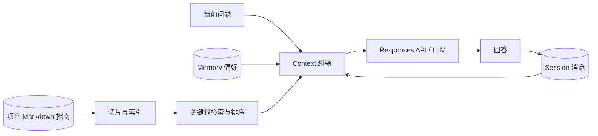

# 03 · Agent 的信息组织与获取：Context、Session、Memory、RAG

> **实验项目：Agent 学习资料助手。** 它回答关于本仓库实验的问题。资料来自仓库里真实存在的三个实验指南；对话和长期偏好保存在本地 SQLite。模型在每次提问时只看到 Python 程序选出的那一小部分信息。

完成本实验后，你应该能够打开一次模型调用的输入，指出哪些内容来自当前提问、哪些来自 Session、哪些来自 Memory、哪些来自文档检索；也能解释同一个问题为什么会因 Context 不同而得到不同回答。

## 从工具连接走向信息组织

前面的实验展示了如何让模型请求工具，以及 Python 如何执行本地函数、REST API 或 MCP 工具。但“能调用工具”并不等于“知道这次该把哪些信息交给模型”。如果只把最新一句话发送给模型，它可能不知道“刚才提到的第二个工具”指什么；如果把所有历史和全部文档都发送过去，又会产生冗余、冲突和成本。

这次我们把关注点放在**调用模型之前**的准备工作。应用程序先恢复会话、召回值得复用的偏好、检索相关资料，再组装本次输入。模型权重没有被修改；下一次模型调用仍需要重新获得这些信息。

| 概念 | 本实验中的实体 | 它解决的问题 |
| --- | --- | --- |
| **Context** | `instructions` 加本次 `input` 消息 | 模型这一次究竟能依据什么回答？ |
| **Session** | SQLite 中按 `session_id` 保存的消息 | 追问如何接上同一段交互？ |
| **Memory** | 按 `profile + key` 保存、可更新和删除的偏好 | 哪些信息值得跨会话复用？ |
| **RAG** | 从已有项目指南中检索片段，再放入本次输入 | 如何按需引用外部文档，而不把整份文档塞给模型？ |

本实验的术语沿用提供的学习材料中的工程划分。**Session 里有记录，不代表记录一定进入 Context；Memory 已经存储，也不代表它自动被召回；RAG 检索到片段，也必须实际放入本次输入，模型才能直接使用。**



## 代码地图

| 文件 | 负责什么 | 重点观察 |
| --- | --- | --- |
| [`learning_agent.py`](learning_agent.py) | 命令行入口与真实 Responses API 调用 | `ask()` 先取信息、再调用模型、最后保存问答。 |
| [`context.py`](context.py) | 本次 Context 的选择与组装 | `build_context()` 的预算、优先级和历史裁剪。 |
| [`store.py`](store.py) | SQLite 数据层 | Session 按 ID 隔离；Memory 按 profile 保存、更新、遗忘。 |
| [`retrieval.py`](retrieval.py) | Markdown 切片、索引与检索 | `index_project()` 和 `search()` 展示 RAG 的检索阶段。 |
| [`test_learning_agent.py`](test_learning_agent.py) | 无需 API 的边界验证 | 会话隔离、记忆更新、真实文档命中、预算限制。 |

这个项目没有再实现复杂的 Harness，也没有让模型自行决定何时检索。**Python 在模型调用前进行检索和 Context 组装，然后调用一次 LLM。** 这样更容易看到四个概念的边界。前面章节的 Function Calling 仍是另一种可与 RAG 结合的做法。

## 准备

以下命令均在**项目根目录**运行。复用根目录的 `.venv`：

```bash
python3 -m venv .venv  # 如果已经创建过，可跳过
.venv/bin/python -m pip install -r 03_context_session_memory_rag/requirements.txt
```

`search`、`index`、`remember`、`forget`、`show` 和自动化测试完全本地运行。只有 `ask` 会调用真实模型 API，并产生相应的 API 用量。在根目录的本地 `.env` 中设置：

```dotenv
OPENAI_API_KEY=你的完整密钥
OPENAI_MODEL=你的账户可用的模型
```

若没有 `.env`，可先从根目录的 `.env.example` 复制。`.env`、`.venv` 和本实验生成的 `*.sqlite3` 都被 Git 忽略；不要把密钥写进代码或命令参数。

## 实验 0：建立知识索引，不调用模型

```bash
.venv/bin/python 03_context_session_memory_rag/learning_agent.py index
.venv/bin/python 03_context_session_memory_rag/learning_agent.py search 'MCP Server REST API tool request'
```

`index` 读取 `00_agent_system_basics/README.md`、`01_llm_agent_and_toolcalling/README.md` 和 `02_external_capabilities/README.md`，按标题、段落切片，写入本地数据库。`search` 打印排名分数、来源文件、章节和内容预览。修改原指南后，重新运行 `index`，旧切片会被替换。

这里的检索使用**英文词和中文双字片段**，再根据关键词出现范围和标题命中排序。没有 Embedding，也没有向量数据库：**RAG 是“检索 → 选证据 → 增强输入 → 生成”的方法，不等于某一种索引技术。** 你可以改写搜索词，观察关键词检索漏掉同义表达的情况。

## 实验 1：看清一次 Context 到底长什么样

```bash
.venv/bin/python 03_context_session_memory_rag/learning_agent.py ask \
  'In this project, what does the MCP Server call after receiving a tool request?' \
  --session context-a --trace
```

输出中的 `=== Instructions sent to model ===` 和 `=== Input sent to model ===` 就是这次 `responses.create(...)` 的两个核心输入。你会看到当前问题、检索到的片段及其路径；如果这个 Session 已有问答，还会看到被选中的历史消息。`Answer` 是模型返回的文本，**不是**检索器直接给出的答案。

终端还会显示 `Context: 已使用字符数/预算字符数` 与 API 实际报告的 `input_tokens`、`output_tokens`。教学预算按 Python 字符数粗略控制，**不是模型的真实 Context Window，也不是精确 Token 计数**。真实 Token 用量以 API 返回的 `usage` 为准。

### 代码中的顺序

1. `store.messages(session_id)` 取得当前会话历史；`store.memories(profile)` 取得长期记录。
2. `search(...)` 在本地索引中挑选与问题相关的文档片段。
3. `build_context(...)` 在预算内依次放入文档、记忆和最近的完整问答；当前问题始终保留。
4. `client.responses.create(model=..., instructions=..., input=...)` 将选好的内容交给模型。
5. 成功得到回答后，`append_exchange(...)` 才把问答写回 Session，供下一次使用。

## 实验 2：Session 让追问有前文，且相互隔离

先让 `session-a` 获得一条有依据的回答：

```bash
.venv/bin/python 03_context_session_memory_rag/learning_agent.py ask \
  'In the six-room cleaner, what are the move cost and clean cost?' \
  --session session-a
```

然后向两个 Session 提出相同的追问。这次关闭 RAG，专门观察历史消息的作用：

```bash
.venv/bin/python 03_context_session_memory_rag/learning_agent.py ask \
  'Which of those two costs is higher?' --session session-a --no-rag --trace

.venv/bin/python 03_context_session_memory_rag/learning_agent.py ask \
  'Which of those two costs is higher?' --session session-b --no-rag --trace
```

在 `session-a` 的 trace 中，应能看到此前的一问一答；`session-b` 没有这段历史。模型输出不保证字字相同，但第二个 Session 没有可靠依据判断“那两个成本”具体指什么。运行 `show --session session-a` 和 `show --session session-b` 可查看数据库中的消息。关闭终端后再次运行 `show`，历史依然存在，说明 Session 由应用程序的 SQLite 状态恢复，模型并未自动记住它。

`--no-session` 只让**本次模型调用**不携带旧消息；本次成功的问答仍会写入指定 Session，便于下一次实验。不要把这开关理解为删除 Session。

## 实验 3：Memory 跨会话复用、更新与遗忘

这里采用**显式写入**：由你判断哪条偏好值得长期保存。普通聊天不会自动变成 Memory，这样可以直接观察“选择性写入”和“仅存历史”的区别。

```bash
.venv/bin/python 03_context_session_memory_rag/learning_agent.py remember \
  explanation_style 'Explain principles and include a small runnable example.'

.venv/bin/python 03_context_session_memory_rag/learning_agent.py ask \
  'Explain why an MCP tool request is not the same as executing the tool.' \
  --session memory-a --trace
```

`memory-a` 是全新的 Session，但 trace 中应出现 `[Saved memory: explanation_style]`。再用另一新 Session 和 `--no-memory` 提相同问题，对照 `memories` 计数与实际输入：

```bash
.venv/bin/python 03_context_session_memory_rag/learning_agent.py ask \
  'Explain why an MCP tool request is not the same as executing the tool.' \
  --session memory-b --no-memory --trace
```

更新与删除同一个 `key`：

```bash
.venv/bin/python 03_context_session_memory_rag/learning_agent.py remember \
  explanation_style 'Explain briefly; use one concrete example.'
.venv/bin/python 03_context_session_memory_rag/learning_agent.py show --session memory-a
.venv/bin/python 03_context_session_memory_rag/learning_agent.py forget explanation_style
```

同一个 `profile` 的不同 Session 可以召回同一条 Memory；不同 `profile` 不会相互读取。需要模拟第二位学习者时，把 `--profile another_student` 放在子命令**之前**。`show` 中的 Session 历史不会因为 `forget` 一条 Memory 而被删除，这正好展示二者的边界。

## 实验 4：RAG 按需提供项目证据

对同一个**项目特定问题**分别关闭与开启 RAG，使用不同的 Session 避免历史污染：

```bash
.venv/bin/python 03_context_session_memory_rag/learning_agent.py ask \
  'In this project, what does the MCP Server call after receiving a tool request?' \
  --session rag-off --no-rag --trace

.venv/bin/python 03_context_session_memory_rag/learning_agent.py ask \
  'In this project, what does the MCP Server call after receiving a tool request?' \
  --session rag-on --trace
```

`rag-off` 的模型输入没有项目文档片段，应说明无法核实项目特定实现；`rag-on` 的输入包含带来源的指南片段，可以据此回答 MCP Server 会向 REST API 发请求，并标出来源。模型仍有随机性，验证时以 **trace 中是否真有证据**和**回答是否与证据一致**为准，而不是要求固定措辞。

一次真实试运行中，检索片段包含了 `02_external_capabilities/README.md` 的“第三站：让 MCP 发布并调用这些能力”；模型回答提到了 MCP Server 经 REST API 请求 `18080` 端口，并给出文档来源。这个观察说明的是**本次检索和组装有效**，不是所有问题都能靠关键词检索得到正确片段。

## 实验 5：缩小预算，观察 Context 被裁剪

在已经有历史的 Session 上重复提问，并改变 `--budget`：

```bash
.venv/bin/python 03_context_session_memory_rag/learning_agent.py ask \
  'What are the move and clean costs in the six-room cleaner?' \
  --session session-a --budget 1600 --trace
```

对照默认预算 `6000`，观察 `document chunks`、`memories`、`history messages` 以及打印出的实际输入。程序只纳入**完整**的文档片段和问答配对；旧消息可能因为预算不足而被舍弃。这里展示的是 Context Engineering 中最基础的 **selection / truncation / structuring**，没有实现自动摘要。较短 Context 不必然更好，需看它是否保留了本题真正需要的证据。

## 验证与局限

本地验证不消耗 API 用量：

```bash
.venv/bin/python -m unittest discover -s 03_context_session_memory_rag -p 'test_*.py' -v
```

| 你应能验证 | 看哪里 |
| --- | --- |
| 同一个 `session_id` 能恢复历史，不同 Session 不共享历史 | `show` 与 `--trace` |
| Memory 能跨 Session 召回，也能覆盖和删除 | `remember`、`show`、`forget` |
| RAG 结果有文档来源，关闭 RAG 后不会偷偷出现 | `search`、`--no-rag --trace` |
| 真正送进模型的信息受预算控制 | `Context` 计数与 `=== Input sent to model ===` |
| 字符预算与模型 Token 用量不是一回事 | `Context` 计数与 `Model usage` |

这个教学实现只索引三个明确列出的本地 Markdown 文件，采用关键词检索；它无法像语义向量检索那样自然处理所有同义表达，也不会自动判断文档是否过时。Memory 由用户显式写入，未做自动抽取。引用和最终答案由模型生成，仍应结合来源检查。SQLite 数据库只保存在本机 `03_context_session_memory_rag/data/learning.sqlite3`，不会提交到远程。
