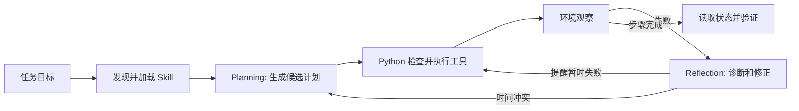

# 04｜让计划经得起现实：Planning、Reflection 与 Skill

一个会调用日历工具的 Agent，仍可能在多步骤任务中失败：它查到空闲时间后，别人恰好占用了这个时间；它创建了会议，却没能设置提醒。本实验让这些变化真实发生在**虚拟日历**中，观察模型的计划怎样变成 Python 的工具调用，以及失败反馈怎样改变后续行动。

本目录延续前面章节的 Agent Loop 和工具执行概念，但只保留学习这三个机制所需的最小结构。这里没有真实日历账号、网络服务或复杂 Harness。

## 你将看到什么

任务固定为：在 **2030-05-20** 的候选时段安排一场 30 分钟技术讨论会，避开已有安排，并提前 30 分钟提醒。虚拟时段为 `10:00`、`10:30`、`11:00`、`11:30`；最初 `10:00` 已占用。

| 阶段 | 输入 | 输出 | 负责者 |
| --- | --- | --- | --- |
| Skill 发现与加载 | 任务文本、Skill 元数据 | 可复用的办会流程 | `load_skill()` |
| Planning | 目标、日历状态、约束、Skill 正文 | 候选时段与有序步骤 | 模型或演示决策器 |
| 执行 | 计划中的工具操作 | 真实日历状态、成功或错误 | Python `CalendarWorld` |
| Reflection | 预期、工具观察、当前状态 | 诊断与修正建议 | 模型或演示决策器 |
| Replanning | 变化后的日历 | 新的候选计划 | 模型或演示决策器 |
| Verification | 已保存的会议 | 时间和提醒是否都符合目标 | Python `verify()` |

> **关键界线：** 模型生成的 JSON 是候选决策；它不会自行运行 `create_meeting()`。Python 检查计划、调用工具、收集结果，最后读取日历验证。结构化输出保证 JSON 的形状，不保证计划一定可执行。

## 文件如何配合

| 文件 | 职责 |
| --- | --- |
| [`agent.py`](agent.py) | 发现 Skill、请求计划和反思、校验决策、执行有限次数的循环并打印轨迹。 |
| [`calendar_world.py`](calendar_world.py) | 保存虚拟日历，模拟冲突和一次性提醒故障，实现查询、创建、提醒与验证。 |
| [`skills/schedule-meeting/SKILL.md`](skills/schedule-meeting/SKILL.md) | 会议安排的可复用操作方法；不是工具实现。 |
| [`test_lab.py`](test_lab.py) | 离线验证计划模式、反思模式和最终状态。 |



Skill 的元数据先被发现；只有匹配任务且 `--skill on` 时，正文才进入计划和反思的输入。这展示了**渐进披露**。其正文告诉 Agent 可复用的做事方法；实际读写日历仍由 `calendar_world.py` 完成。`--skill off` 可以比较有无这段方法文本时的决策输入，但单次结果相同或不同都不能证明 Skill 的总体效果。

## 运行

从仓库根目录执行。默认是**离线演示**，不耗费 API；它使用明确的规则来模拟计划与反思，所以输出可复现。真实模型入口使用仓库根目录 `.env` 中的 `OPENAI_API_KEY` 和 `OPENAI_MODEL`。如果终端里也设置了同名变量，本实验以项目 `.env` 为准，避免误用另一把 Key。

```bash
# 无需安装依赖：先看完整轨迹
.venv/bin/python 04_planning_reflection_skill/agent.py

# 只执行初始计划，不根据失败反馈修正
.venv/bin/python 04_planning_reflection_skill/agent.py --mode plan-only

# 用真实模型做 Planning 和 Reflection
.venv/bin/python -m pip install -r 04_planning_reflection_skill/requirements.txt
.venv/bin/python 04_planning_reflection_skill/agent.py --engine llm

# 对照 Skill 是否加载，或关闭故障看正常流程
.venv/bin/python 04_planning_reflection_skill/agent.py --skill off
.venv/bin/python 04_planning_reflection_skill/agent.py --no-faults
```

真实模型运行会产生 API 费用，模型输出可能变化。`--engine demo` 的 `Decision` 行是规则决策，**不是模型 API 返回**；`--engine llm` 的 `Decision` 行才来自 Responses API。两者使用相同的工具和验证逻辑。

## 顺着一次完整轨迹读代码

1. `list_events()` 观察到 `10:00` 忙，初始计划通常选择 `10:30`，并列出 `create_meeting → set_reminder → verify`。此时只有**计划**，日历尚未改变。
2. 环境在执行前占用 `10:30`。`create_meeting()` 根据**最新状态**返回 `SLOT_CONFLICT`。原计划的依据已失效。
3. Reflection 接收“预期成功、实际冲突”和新日历，建议 `replan`。Python 再查询日历，Planning 通常改选 `11:00`。这是重新规划，而不是重复调用旧参数。
4. `create_meeting()` 成功返回 `meeting-1`。首次 `set_reminder()` 返回 `TEMPORARY_REMINDER_FAILURE`；日历里此时确实有会议，但 `reminder_minutes` 仍为 `null`。
5. Reflection 观察到“会议存在、提醒缺失”，建议 `retry_reminder`。Python 只重试提醒，不再创建一个重复会议。最后 `verify()` 读取已保存的会议，检查时间和 30 分钟提醒。

离线 `--mode plan-only` 在第 2 步后停止，最终 `success: false`；默认 `--mode reflect` 可修复两次故障，最终 `success: true`。这只是这个**固定场景**的对照，不是对所有动态日历任务的性能评估。

轨迹中的 `Decision #` 数的是规划或反思决策次数；只有真实模型入口下它才对应 Responses API 请求次数。结果中的 `model_api_calls` 在离线演示时为 0。`Tool #` 数的是 Python 实际执行的日历操作次数。`Environment change` 是测试故障注入，既不是模型调用，也不是模型请求的工具调用。两种计数不能混为一谈。

## 找到三种机制的底层位置

**Planning：** `make_plan()` 把 Goal、State、可用时段、Constraints 和 Skill 正文交给决策器。LLM 通过 Responses API 的 `text.format=json_schema` 返回 `slot`、`steps`、`reason`。Python 随后检查时段是否仍在观察到的空闲集合中，并检查步骤顺序。严格 JSON Schema 只约束字段和枚举；旧状态与现实不一致仍会在执行时暴露。

**Reflection：** `reflect()` 再次读取日历，把 expected、observation 和 current_state 交给决策器。返回的 `diagnosis` 解释差异，`correction` 限定为 `replan`、`retry_reminder` 或 `stop`。Python 还会检查建议与错误类型是否一致。反思不是修改模型权重，也不能替代最后的状态验证。

**Skill：** `SKILL.md` 用简短的 `name` 和 `description` 供发现，正文记录“查询→创建→提醒→验证”和失败后的处理方法。它是一份可复用流程，不是 Python 函数、API、MCP Server 或工具调用结果。你可以修改正文再运行 `--engine llm`，观察模型的**候选计划**是否改变；判断任务是否成功仍看工具结果与 `verify()`。

## 自己动手的四个实验

1. **看计划与现实的差异：** 分别运行 `--mode plan-only` 和默认模式，找出第一次 `SLOT_CONFLICT` 之后各自做了什么。解释为什么旧计划不能直接重试。
2. **看针对性修复：** 在 `calendar_world.py` 中把提醒故障改为持续失败。观察两次尝试后最终验证仍失败，解释为什么“反思过”不等于“已完成”。
3. **看 Skill 的作用边界：** 在 `--engine llm` 下分别使用 `--skill on/off`，比较规划请求中的 Skill 正文、模型计划及最终状态。避免用一次运行得出普遍结论。
4. **看校验层：** 暂时让 `DemoDecider` 返回已占用的时段，或把步骤顺序调换。观察 Python 在执行前拒绝候选计划。

执行离线回归检查：

```bash
.venv/bin/python -m unittest discover -s 04_planning_reflection_skill -p 'test_*.py'
```

## 理解限制

这里的时间是固定的实验测试数据，日历只存在于进程内存；程序退出后不保存。故障是有意注入的，以便稳定观察重新规划和反思。真实应用还需处理时区、参与者确认、并发写入、持久化与权限等问题。

这个实验只展示 Planner、Reflector、Skill 和执行器之间的职责关系。
