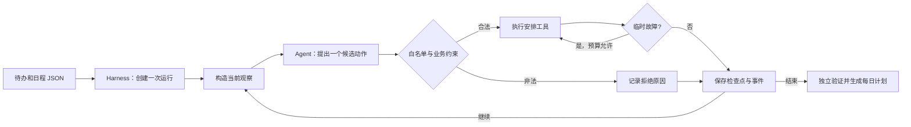

# 05｜给 Agent 装上驾驶舱：研究与工作冲刺台

你上午要跑 Agent 评估，下午要读论文、给导师写汇报，还要准备团队演示。Agent 可以建议“下一步安排什么”，但谁来保证它不会占用组会时间、跳过前置任务、无限尝试或在失败后丢失进度？本实验把这些职责交给一个小型 **Harness**，最终生成一份能直接用于当天工作的专注计划。

本项目同时适合计算机研究生和 AI 工程师：任务可以是论文阅读、模型评估、实验复盘和团队汇报。你可以编辑自己的待办 JSON，运行后得到带勾选框、截止日期和收工复盘问题的 `sprint_brief.md`。它在本地运行，不连接真实日历。

> **一句话区分：** Agent 提出“把 `eval` 放在 `09:00`”；Harness 决定这个动作能否执行、调用哪个业务函数、失败后是否重试、何时暂停、保存什么，以及最终是否达成目标。

## 从 Planning 到 Harness

上一目录的重点是计划怎样在环境反馈后改变。本目录把视角移到**运行系统**：即使决策器换成真实 LLM，运行边界和可观察性也应保持一致。这里没有分布式队列、复杂服务或真实日历权限；一个 Python 进程就足够看清核心机制。



**模型没有直接执行工具。** `--engine llm` 使用 Responses API 的结构化 JSON 输出，让模型每轮返回 `action`、`task_id`、`slot_id`、`reason`。Python 收到候选动作后再校验与执行。这里刻意不使用 Function Calling，是为了看清 Harness 如何控制动作执行；前面两个实验已展示模型原生工具请求与 MCP 接入。

## 一次冲刺包含什么

示例 [`example_day.json`](example_day.json) 有 6 个一小时的时段，其中 `11:00–12:00` 已被组会占用。4 个任务共需要 5 个专注块：跑评估占 2 块，读论文、写汇报、准备演示各占 1 块；写汇报依赖评估完成。

| 谁负责 | 具体工作 | 在代码哪里 |
| --- | --- | --- |
| 决策器 | 根据当前待办、已安排时段和上次结果提出一个候选动作 | [`decision.py`](decision.py) |
| Harness | 限制决策与工具尝试次数、检查动作白名单、执行工具、重试临时故障、保存检查点、记录事件 | [`harness.py`](harness.py) |
| 业务环境 | 判断时段是否忙、任务是否已排满、前置任务是否完成 | [`workspace.py`](workspace.py) |
| 验证器 | 从实际安排重放并检查所有任务是否满足 | `workspace.py` 中的 `verify()` |
| 用户 | 编辑待办、决定是否续跑、按生成的清单实际开展工作 | `example_day.json` 与 `sprint_brief.md` |

这份划分很关键：**决策器可以更换，Harness 仍然守住同一套边界。** `DemoDecider` 是可复现的规则，不代表真实模型行为；`LLMDecider` 会调用 API。两者都只返回候选动作，不拥有日程的写入权。

## 先运行一次

从仓库根目录执行；默认离线模式只用 Python 标准库，不消耗 API 额度。

```bash
.venv/bin/python 05_harness/harness.py start
```

输出会按序号显示 `run_started → decision → tool_result → … → verification`。最后会打印一个 `run_id`，以及以下三个文件的路径：

| 文件 | 用途 |
| --- | --- |
| `checkpoint.json` | 当前任务、安排、预算计数、最近一次工具结果；续跑从这里恢复。 |
| `events.jsonl` | 每行一个事件，保留本次运行中“何时提出、何时执行、结果如何”的轨迹。 |
| `sprint_brief.md` | 可直接打开或打印的每日专注清单；暂停时也会生成阶段性版本。 |

它们默认保存在 `05_harness/.runs/<run_id>/`，该目录已被 `.gitignore` 排除。示例输入文件会被**复制进检查点**；运行开始后再编辑原 JSON，不会偷偷改变这次运行的依据。

### 观察一次执行层故障

```bash
.venv/bin/python 05_harness/harness.py start --fail-once
```

第一项安排会先得到 `TEMPORARY_TOOL_FAILURE`。Harness 识别出这是**可重试的短暂故障**，在预算内自动尝试同一动作一次；第二次成功后，才继续询问决策器。你会看到 `tool_attempts` 比成功安排的专注块多 1。这个故障由实验注入，用来稳定观察重试机制，不是模型产生的错误。

### 让预算暂停，再从磁盘续跑

```bash
.venv/bin/python 05_harness/harness.py start --max-decisions 2
.venv/bin/python 05_harness/harness.py show <上一步输出的 run_id>
.venv/bin/python 05_harness/harness.py resume <上一步输出的 run_id>
```

第一条命令安排 2 块后触及决策预算，状态变为 `paused`。第三条命令读取同一份 `checkpoint.json`，继续安排剩余任务，既不会重新安排前两块，也不会重新读取初始输入。`resume` 的预算是**整次运行的累计上限**，默认回到 12 次决策、12 次工具尝试；如果已达到默认上限，可以显式给更大的 `--max-decisions` 或 `--max-tool-attempts`。

### 换成你的真实任务

复制 `example_day.json` 到一个本地文件，编辑日期、任务、优先级、截止日期、所需专注块和已有安排，再运行：

```bash
cp 05_harness/example_day.json 05_harness/my_day.json
.venv/bin/python 05_harness/harness.py start --input 05_harness/my_day.json
```

上例中的 `my_day.json` 已被 `.gitignore` 排除，适合放个人安排；公开可复用的样例仍放在 `example_day.json`。

`priority` 使用 1–5；`blocks` 是所需的一小时专注块数；`depends_on` 填其他任务的 `id`。时段 `id` 使用 `HH:MM` 并按时间排序。默认决策器先看截止日期，同日再看优先级，并且只在前置任务安排完成后安排依赖任务。如果专注时段不足，程序会把未完成项写进计划的“尚需处理”部分，状态为 `incomplete`，不会假装全都做完。

### 可选：让真实 LLM 决定下一步

仓库根目录 `.env` 需要 `OPENAI_API_KEY` 和支持结构化输出的 `OPENAI_MODEL`。安装本目录依赖后执行：

```bash
.venv/bin/python -m pip install -r 05_harness/requirements.txt
.venv/bin/python 05_harness/harness.py start --engine llm
```

LLM 模式每次 `decision` 都会发起一次模型 API 请求并产生费用；`model_calls` 记录这个次数。模型可能提出无效任务或时段，Harness 会记录具体工具错误；若其他决策器给出未知动作，白名单会记录 `rejected`。严格 JSON Schema 只约束返回形状，不能代替时段、依赖和最终结果的校验。

## 顺着一条轨迹理解 Harness

默认示例中，离线决策器通常先为 `eval` 选择 `09:00` 和 `10:00`，保留 `11:00` 组会，再为论文、汇报和演示安排下午三个时段。请看四个容易混淆的边界：

1. **`decision` 是提案。** `DemoDecider.decide()` 或 LLM 返回的 JSON 此时还没有改变日程。
2. **`tool_result` 是执行事实。** `Harness._execute()` 调用 `schedule_focus()` 后才可能新增一条安排。短暂故障第一次不会写入业务状态。
3. **`checkpoint` 是运行进度。** 其中保存已执行的安排、上次结果和累计计数；`resume` 继续同一运行，而不是从头再问一遍。
4. **`verification` 是最终判定。** 即使 Agent 返回 `finish`，Harness 仍调用 `verify()` 重放安排，检查占用、依赖和任务块数。提前 `finish` 会得到 `incomplete`，后续可以 `resume` 继续修复。

`decisions` 数 Agent 提案次数；`model_calls` 只数真实模型 API 请求；`tool_attempts` 数 Python 实际尝试执行安排的次数。三者在 `--fail-once`、拒绝非法动作或离线模式下明显不同。

本次使用示例数据得到的两条实际轨迹如下；真实模型的具体安排和调用次数可能随运行变化：

| 运行 | 决策次数 | 模型 API 请求 | 工具执行尝试 | 最终验证 |
| --- | ---: | ---: | ---: | --- |
| `demo --fail-once` | 6 | 0 | 6（含一次失败后重试） | 5/5 块，成功 |
| `llm` | 6 | 6 | 5 | 5/5 块，成功 |

这里的 `completed` 仅表示**安排任务的运行已完成**，不是论文、评估和汇报已被真实做完。生成的勾选框需要你在工作中自行更新。

## 值得动手改的三个地方

1. **让一个时段被占用：** 在自己的 JSON 中把 `14:00` 设为 `busy: true`。观察剩余专注块是否足够，以及 `verify()` 如何报告缺口。
2. **制造非法决策：** 暂时让 `DemoDecider` 返回不存在的工具名，或把依赖 `eval` 的 `brief` 安排在 `09:00`。比较 `rejected` 与 `DEPENDENCY_NOT_READY`：前者由 Harness 的动作白名单挡住，后者由业务环境挡住。
3. **观察重试预算：** 运行 `start --fail-once --max-tool-attempts 1`，再 `resume`。第一次故障消耗掉工具预算，但没有安排成功；续跑会使用新预算继续，不会把失败当成完成。

离线回归检查：

```bash
.venv/bin/python -m unittest discover -s 05_harness -p 'test_*.py' -v
```

## 本实验的边界

生成的时间线是**建议和个人清单**，不会写进真实日历，也不会替你完成论文或评估。一个时段固定为一小时；没有跨天排程、多人协作或后台任务队列。检查点使用临时文件替换，事件日志使用 JSONL，足以观察机制，但没有实现数据库事务级的崩溃恢复。业务验证检查的是“安排是否合理”，实际任务做完后仍要由你勾选和复盘。

掌握这里的运行状态、预算、白名单、执行、重试、日志、续跑和独立验证，后续再接入真实日历、MCP 工具或更复杂的任务编排时，就能看清哪些能力属于 Agent，哪些应该由 Harness 稳定提供。
