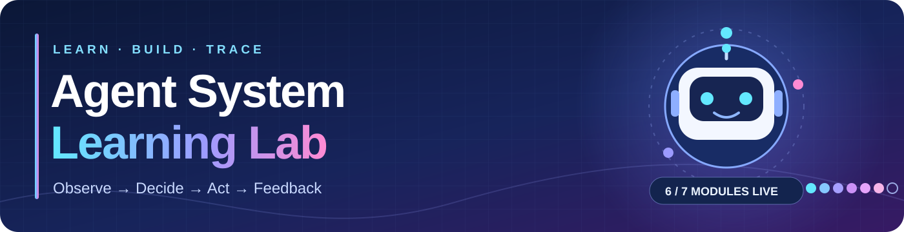
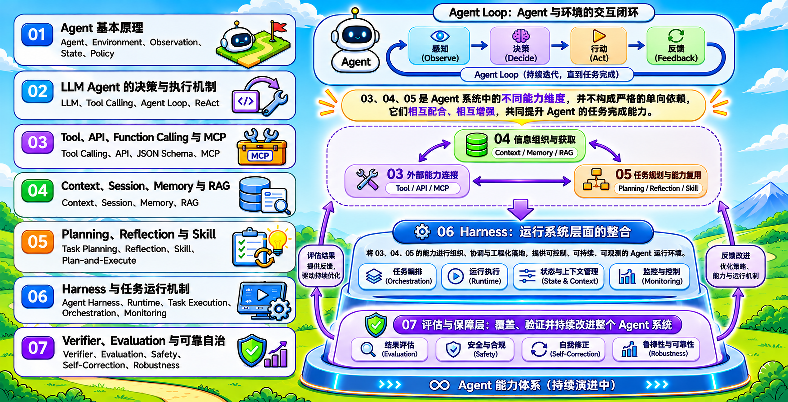

<p align="center">
  
</p>

# Agent System Learning Lab

<p align="center"><strong>Build an agent. Watch it decide. Trace what actually runs.</strong></p>
<p align="center">🧪 5 runnable labs &nbsp;·&nbsp; 🧭 7-module roadmap &nbsp;·&nbsp; 🔄 Actively updated / 持续更新中</p>
<p align="center"><a href="#choose-a-lab">Choose a lab</a> · <a href="#learning-roadmap">Explore the roadmap</a> · <a href="#study-notes">Study notes</a> · <a href="#quick-start">Quick start</a></p>

Follow an agent from a simple room-cleaning policy to LLM tool decisions, external capabilities, context assembly, and plans that change after feedback. Each completed module pairs runnable Python with an experiment guide. The detailed guides and code comments are primarily in Chinese.

## Choose a lab

Follow **01 → 05** in order, or pick the topic you want to explore.

| Step | Lab | Focus | Open |
| :---: | --- | --- | --- |
| **01** | 🧹 Agent fundamentals | Chosen action → environment execution | [Guide](00_agent_system_basics/README.md) · [Code](00_agent_system_basics/cleaning_agent.py) |
| **02** | 📚 LLM agent loop | Model tool request → Python execution | [Guide](01_llm_agent_and_toolcalling/README.md) · [Code](01_llm_agent_and_toolcalling/agent_loop.py) |
| **03** | 📱 Tool integration | Local functions → REST API → MCP | [Guide](02_external_capabilities/README.md) · [Code](02_external_capabilities/agent.py) |
| **04** | 🧠 Context & memory | Session → Memory → RAG context | [Guide](03_context_session_memory_rag/README.md) · [Code](03_context_session_memory_rag/learning_agent.py) |
| **05** | 🧩 Planning & skills | Plan → reflect → replan | [Guide](04_planning_reflection_skill/README.md) · [Code](04_planning_reflection_skill/agent.py) |

## Learning Roadmap



The roadmap starts with the agent–environment loop: **observe → decide → act → receive feedback**. Modules 03–05 develop complementary capabilities: connecting tools, organizing information, and planning work. Module 06 brings those capabilities into an observable runtime, while Module 07 evaluates and improves the resulting system. These topics reinforce one another; the diagram is a learning map, not a strict dependency graph.

| Module | Topic | What the experiments cover | Entry points | Status |
| --- | --- | --- | --- | --- |
| 01 | 🧹 Agent fundamentals | Observation, actions, environment state, policies, and action costs in a six-room cleaning agent. | [Guide](00_agent_system_basics/README.md) · [Main code](00_agent_system_basics/cleaning_agent.py) | 🟢 Live |
| 02 | 📚 LLM decisions and the agent loop | Responses API function calls, tool execution, feedback, and the effect of instructions and `tool_choice`. | [Guide](01_llm_agent_and_toolcalling/README.md) · [Main code](01_llm_agent_and_toolcalling/agent_loop.py) | 🟢 Live |
| 03 | 📱 Tools, APIs, function calling, and MCP | Three ways to connect the same virtual phone capabilities: local Python functions, REST API, and MCP. | [Guide](02_external_capabilities/README.md) · [Main code](02_external_capabilities/agent.py) | 🟢 Live |
| 04 | 🧠 Context, sessions, memory, and RAG | Build context from persisted sessions, selected memories, and retrieved project documentation. | [Guide](03_context_session_memory_rag/README.md) · [Main code](03_context_session_memory_rag/learning_agent.py) | 🟢 Live |
| 05 | 🧩 Planning, reflection, and skills | Discover and load a reusable procedure, plan a meeting, revise after a conflict, and repair a failed reminder. | [Guide](04_planning_reflection_skill/README.md) · [Main code](04_planning_reflection_skill/agent.py) · [Skill](04_planning_reflection_skill/skills/schedule-meeting/SKILL.md) | 🟢 Live |
| 06 | ⚙️ Harness and task runtime | Coordinating execution, state, limits, and monitoring around an agent. | — | 🟣 Planned |
| 07 | 🛡️ Verification, evaluation, and reliability | Checking outcomes, measuring performance, handling failures, and improving robustness. | — | 🟣 Planned |

The roadmap numbers describe the learning sequence. The code directories use `00` through `04`; the entry points above lead to their guides and main scripts.

## Study Notes

The accompanying Notion notes provide the conceptual reading for these experiments. Open the relevant note before running a lab, then return to the code and traces to test the ideas.

| Topic | Notion notes | Related lab |
| --- | --- | --- |
| Agent fundamentals and LLM agents | [Read notes](https://sphenoid-rhodium-72f.notion.site/Agent-Agent-LLM-Agent-40d9d02716b6802682e9c9ed6b4ba43c) | [01](00_agent_system_basics/README.md) · [02](01_llm_agent_and_toolcalling/README.md) |
| Tools, APIs, Function Calling, and MCP | [Read notes](https://sphenoid-rhodium-72f.notion.site/Agent-Agent-Tool-API-Function-Calling-MCP-4109d02716b680f4bb5cc93f9383b68f) | [03](02_external_capabilities/README.md) |
| Context, Session, Memory, and RAG | [Read notes](https://sphenoid-rhodium-72f.notion.site/Agent-Agent-Context-Session-Memory-RAG-4109d02716b680a8a3f5c6482bf87564) | [04](03_context_session_memory_rag/README.md) |
| Planning, Reflection, and Skill | [Read notes](https://sphenoid-rhodium-72f.notion.site/Agent-Agent-Planning-Reflection-Skill-4109d02716b680a68216c1bfb3f033da) | [05](04_planning_reflection_skill/README.md) |

Notion controls access to these pages. Repository links do not change their sharing permissions; readers need the pages to be published or shared with them.

## Inside the live labs

### 🧹 01 · Agent fundamentals

The [six-room cleaning agent](00_agent_system_basics/README.md) separates an agent's chosen action from the environment's execution of that action. It compares a basic policy with a minimum-cost policy and checks 100 randomly selected initial states for completion, valid actions, and bounded execution.

### 📚 02 · LLM decisions and the agent loop

The [library agent](01_llm_agent_and_toolcalling/README.md) lets a model request tools to locate books, check availability, and retrieve loan policies. Python validates and executes each request, returns the result, and calls the model again. A [run comparison report](01_llm_agent_and_toolcalling/instruction_tool_choice_report.md) records how different instructions and tool-choice settings affected actual API responses and tool calls.

### 📱 03 · External capabilities

The [virtual phone lab](02_external_capabilities/README.md) exposes calendar and note operations through three backends while keeping the agent's task comparable. Its diagrams and traces show where function calling ends, where Python executes work, and how REST and MCP requests travel between processes.

### 🧠 04 · Context, Session, Memory & RAG

The [study assistant](03_context_session_memory_rag/README.md) retrieves passages from the project's own guides, keeps session history and reusable preferences in SQLite, and prints the exact context assembled for each model call. Its experiments compare answers with and without history, memory, or retrieved evidence.

### 🧩 05 · Planning, Reflection & Skill

The [virtual meeting lab](04_planning_reflection_skill/README.md) turns a scheduling goal into an explicit plan, injects a calendar conflict and a reminder failure, and traces how feedback changes the next action. Its [sample Skill](04_planning_reflection_skill/skills/schedule-meeting/SKILL.md) exposes a short name and description for discovery, then loads the meeting procedure only when it applies. The Skill guides decisions; Python still executes calendar operations and verifies the saved result. Compare a reproducible offline run with an optional real LLM planner.

## Coming next

- **⚙️ 06 · Harness and runtime:** Put the agent inside a controlled execution loop with explicit state, limits, logs, and monitoring so a complete run can be inspected and reproduced.
- **🛡️ 07 · Evaluation and reliability:** Define success criteria, build repeatable test cases, and study incorrect tool use, recovery, and self-correction across varied inputs.

These are planned learning objectives, not completed experiments. New code and guides will appear here as each module is built.

## Quick start

Create a virtual environment if you do not already have one, then run the first experiment from the repository root:

```bash
python3 -m venv .venv
.venv/bin/python 00_agent_system_basics/cleaning_agent.py
```

The LLM experiments require dependencies and an API key. Install the requirements for the module you want to run, copy the example configuration, and set your own `OPENAI_API_KEY` and `OPENAI_MODEL` in the local `.env` file:

```bash
.venv/bin/python -m pip install -r 01_llm_agent_and_toolcalling/requirements.txt
test -f .env || cp .env.example .env
.venv/bin/python 01_llm_agent_and_toolcalling/agent_loop.py baseline --trace
```

The virtual phone lab has [additional dependencies and setup steps](02_external_capabilities/README.md), including separate local services for its REST and MCP backends. The `.env` file and `.venv` directory are ignored by Git. Follow each module's README for its full setup, exercises, and expected observations.

To explore Planning, Reflection, and Skill without an API call, run:

```bash
.venv/bin/python 04_planning_reflection_skill/agent.py
```

The [module guide](04_planning_reflection_skill/README.md) shows how to compare the initial plan, reflection, Skill loading, and the real LLM mode.
